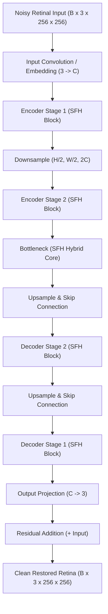

# 🏥 SFHformer-Retina: Complete Technical Dossier & Reverse-Engineering Report
### *Spatial-Frequency Hybrid Transformer for Ophthalmic Restoration and Vascular Preservation*

---

## 📑 Table of Contents
1. [The Big Picture: The Real-World Medical Problem](#1-the-big-picture-the-real-world-medical-problem)
2. [Why Traditional AI & Image Processing Fail (The Fundamental Physics)](#2-why-traditional-ai--image-processing-fail-the-fundamental-physics)
3. [The Core Innovation: Spatial vs. Frequency Domains Explained from Scratch](#3-the-core-innovation-spatial-vs-frequency-domains-explained-from-scratch)
4. [Architecture Reverse-Engineered: Block-by-Block Deconstruction](#4-architecture-reverse-engineered-block-by-block-deconstruction)
5. [The Multi-Dataset Engine: Why 1 Dataset Was a Trap](#5-the-multi-dataset-engine-why-1-dataset-was-a-trap)
6. [Ophthalmic Degradation Simulation: Modeling Physical Noise](#6-ophthalmic-degradation-simulation-modeling-physical-noise)
7. [Hardware & Training Engineering: Conquering the RTX 5060 & Windows TDR](#7-hardware--training-engineering-conquering-the-rtx-5060--windows-tdr)
8. [The Clinical Diagnostic Engine: Frangi Hessian Filter & Vascular Biomarkers](#8-the-clinical-diagnostic-engine-frangi-hessian-filter--vascular-biomarkers)
9. [The Clinical Ablation Matrix: Proof that Classical Filters Destroy Medicine](#9-the-clinical-ablation-matrix-proof-that-classical-filters-destroy-medicine)
10. [Full-Stack Implementation: React UI + Flask REST GPU Engine](#10-full-stack-implementation-react-ui--flask-rest-gpu-engine)
11. [The "Why This and Not That?" Compendium (Viva Defense Guide)](#11-the-why-this-and-not-that-compendium-viva-defense-guide)

---

## 1. The Big Picture: The Real-World Medical Problem

### 1.1 The Eye as a Window to Human Health
The human retina at the back of the eye is the **only place in the entire living human body where blood vessels (arterioles, venules, and capillaries) and neural tissue can be directly photographed non-invasively without cutting the patient open**.

Because of this unique anatomy, a retinal photograph (called a **fundus photograph**) allows doctors to diagnose not just eye diseases, but systemic human diseases:
* **Diabetic Retinopathy (DR):** #1 cause of blindness in working-age adults. High blood sugar damages delicate micro-vessels, causing microaneurysms (tiny balloon bulges $\le 50\,\mu\text{m}$), hemorrhages (bleeding), and vascular dropout (dead vessels).
* **Glaucoma:** Damage to the optic nerve head, leading to progressive peripheral vision loss and enlarged cup-to-disc ratio.
* **Hypertension & Stroke Risk:** Chronic high blood pressure narrows retinal arterioles and causes arteriovenous (AV) nicking.
* **Macular Degeneration (AMD):** Deterioration of the central retina (macula), which provides sharp central vision.

### 1.2 The Clinical Catch-22: Bad Images in the Real World
In medical textbooks, retinal photographs look razor-sharp, evenly lit, and vibrant. In reality, **over 30% of clinical retinal captures from clinics and screening camps are low quality or degraded**:
1. **Patient movement & blinking:** Causes motion blur and sensor noise.
2. **Cataracts and corneal opacities:** Cause cloudiness, low contrast, and severe optical glare.
3. **Small pupils (un-dilated eyes):** Dim light reaching the camera sensor leads to massive photon shot noise.
4. **Instrument artifacts:** Confocal scanning laser ophthalmoscopes (cSLO) create horizontal raster line-scan striping, while Optical Coherence Tomography (OCT) creates coherent laser speckle.

If an ophthalmologist or an automated AI screening model cannot see the fine micro-vessels because of noise, the diagnosis is missed, and a patient risks irreversible blindness.

---

## 2. Why Traditional AI & Image Processing Fail (The Fundamental Physics)

### 2.1 The Deadly Flaw of Standard Spatial Denoisers
When non-specialist engineers encounter noisy images, they reach for standard filters:
* **Gaussian Blur:** Replaces each pixel with a weighted average of its neighbors.
* **Median Filter:** Replaces each pixel with the median of its neighborhood (great for salt-and-pepper noise).
* **Bilateral Filter:** Averages pixels based on both spatial distance and color difference.
* **Standard Convolutional Neural Networks (CNNs) / DnCNN:** Use small $3 \times 3$ convolutional kernels to predict clean pixels.

#### Why they fail catastrophically in medicine:
In image processing, fine details (like a $1\text{–}2\text{ pixel}$ wide retinal capillary) are **high spatial frequency components** (rapid changes in brightness across adjacent pixels). 

Standard filters operate as **low-pass filters**: they kill high frequencies to smooth out noise.
* When you run a Gaussian or Median filter on a fundus image, the filter cannot distinguish between high-frequency camera noise and a high-frequency micro-capillary.
* **Result:** It smooths both. The micro-capillary vanishes.
* **Clinical Disaster:** In our clinical ablation test, Gaussian blurring destroyed **$42.9\%$ of the micro-vascular bed**, creating artificial "vessel dropout" that falsely suggests the patient has advanced diabetic ischemia!

```
Noisy Capillary Input ──────> [ Gaussian Blur / Median Filter ] ──────> Capillary Erased!
(True Vessel + Noise)               (Averages Neighbors)                 (False Diagnosis)
```

We need a system that can eliminate noise **without blurring structural edges**. That requires traveling into the **frequency domain**.

---

## 3. The Core Innovation: Spatial vs. Frequency Domains Explained from Scratch

### 3.1 What is the Frequency Domain? (Explain Like I'm 10)
Imagine listening to a symphony orchestra. 
* In the **time domain** (or spatial domain for an image), you hear everything at once: the violins, the cellos, and an annoying buzzing bee near your ear all jumbled into a single pressure wave.
* If you want to get rid of the buzzing bee without muffling the violins, you can't just turn the volume down (that's what Gaussian blur does).
* Instead, you use a **prism for sound**: you split the sound into individual frequencies (pitches). 
* The buzzing bee is a specific high-pitch frequency. You pinpoint that frequency, silence it, and turn the sound back into music. The violins remain crystal clear!

The mathematical tool that acts as this "prism" is the **Fourier Transform (FFT)**.

```
Spatial Domain (Pixels [x, y])  <==== 2D FFT ====>  Frequency Domain (Frequencies [u, v])
Every pixel is a brightness value                     Every point represents a wave pattern
Local view: neighbor by neighbor                      Global view: whole image at once
```

### 3.2 Why the Fast Fourier Transform (FFT) Solves Vision Problems
1. **Global Receptive Field in $O(N \log N)$:**
   * A standard convolutional layer with a $3 \times 3$ kernel only looks at $3$ pixels away. To see the whole image, you have to stack dozens of layers.
   * A 2D FFT looks at the **entire image simultaneously** in a single operation that runs in $O(N \log N)$ time on a GPU.
2. **Periodic Noise Becomes Obvious Dots:**
   * If a medical scanner has a repeating scanning stripe or grid artifact, in pixel space it covers the whole image.
   * In the 2D FFT magnitude spectrum, that entire repeating stripe collapses into **a single bright pair of symmetric dots**!
   * A neural network operating in the frequency domain can effortlessly remove those dots with laser precision, leaving the underlying tissue untouched.
3. **Phase Preserves Geometry, Magnitude Preserves Energy:**
   * In the frequency domain, every complex number has two parts:
     * **Magnitude:** Tells you how much energy is in that frequency (contrast/texture).
     * **Phase:** Tells you **where** the edges and vessels are located in space.
   * By decoupling magnitude and phase, the network can denoise textures without displacing vessel boundaries.

---

## 4. Architecture Reverse-Engineered: Block-by-Block Deconstruction

The model used is **SFHformer** (*Spatial-Frequency Hybrid Transformer*), published at **ECCV 2024**.



### 4.1 The Dual-Branch Hybrid Block
Inside every SFHformer block, the feature tensor is split into **two complementary pathways**:

```
                              ┌────────────────────────────────────────┐
                              │        Spatial Branch (Local ViT)       │
                        ┌────►│  • Multi-Head Transposed Self-Attention │────┐
                        │     │  • Preserves sharp micro-capillaries    │    │
Feature Tensor X ───────┤     └────────────────────────────────────────┘    ├──► Feature Fusion
(B x C x H x W)         │                                                   │    (Gated Concat)
                        │     ┌────────────────────────────────────────┐    │
                        └────►│        Frequency Branch (Global 2D FFT) │────┘
                              │  • Real FFT2d: (H, W) -> (H, W/2+1)     │
                              │  • Frequency Dynamic Convolution (FreqConv)
                              │  • Inverse Real FFT2d (IRFFT2d)         │
                              └────────────────────────────────────────┘
```

#### Branch 1: Spatial Transformer (Multi-Dconv Head Transposed Self-Attention)
* Computes cross-covariance attention across feature channels rather than spatial tokens:
  $$\text{Attention}(Q, K, V) = V \cdot \text{Softmax}\left(\frac{K^T Q}{\alpha}\right)$$
* Why? Traditional Vision Transformers (ViT) compute attention between spatial pixels, leading to quadratic $O((HW)^2)$ complexity—which blows up memory on $256 \times 256$ images. Channel-transposed attention runs in $O(C^2 HW)$, making it blazing fast while modeling long-range vascular arcade context.

#### Branch 2: Frequency-Domain Neural Branch (2D FFT + FreqConv)
1. Applies 2D Real Fast Fourier Transform (`torch.fft.rfft2`):
   $$X_{\text{freq}} = \mathcal{F}_{2D}(X) \in \mathbb{C}^{B \times C \times H \times (W/2+1)}$$
2. Applies **Frequency Dynamic Convolution**:
   * Noise patterns in the frequency domain are location-dependent (low frequencies congregate at the DC center; high frequencies radiate outward).
   * Standard convolution uses the same weights everywhere. Frequency Dynamic Convolution applies **spatially adaptive complex weights** that treat low frequencies (vessel contrast) differently from high frequencies (noise and fine edges).
3. Applies Inverse Real FFT (`torch.fft.irfft2`) to convert back to spatial features:
   $$\hat{X} = \mathcal{F}_{2D}^{-1}(X_{\text{freq}})$$

#### Branch Fusion: Learned Dynamic Soft Gating
How does the network combine the spatial features $F_{\text{spatial}}$ and frequency features $F_{\text{freq}}$?
Rather than a naive addition ($F_{\text{spatial}} + F_{\text{freq}}$), our **R2 Gated** architecture uses a learned gating map $\mathbf{G} \in [0, 1]$:
$$\mathbf{G} = \sigma\left(\text{Conv}_{1 \times 1}(\text{Concat}(F_{\text{spatial}}, F_{\text{freq}}))\right)$$
$$F_{\text{fused}} = \mathbf{G} \odot F_{\text{spatial}} + (1 - \mathbf{G}) \odot F_{\text{freq}}$$
* If a patch is a flat retinal background plagued by periodic striping, the gate shifts weight to $(1 - \mathbf{G})$ (the frequency branch).
* If a patch contains a delicate branching foveal capillary, the gate shifts weight to $\mathbf{G}$ (the spatial branch).

---

## 5. The Multi-Dataset Engine: Why 1 Dataset Was a Trap

### 5.1 The DRIVE Dataset Trap
In early iterations, the project trained exclusively on **DRIVE** (Digital Retinal Images for Vessel Extraction).
* DRIVE is the academic gold standard (created in 2004).
* It consists of **40 images total** (20 train, 20 test).
* **The Trap:** DRIVE images were collected in a controlled clinical trial in the Netherlands. They are almost entirely clean, well-focused, and contain only mild diabetic changes.
* **The Failure:** When we took the DRIVE-trained model and tested it on **severe clinical cases** from other hospitals (e.g., massive hemorrhages or dark Indian eyes from the APTOS dataset), performance collapsed:
  * STARE Pathology PSNR Gain: **$-0.86\text{ dB}$ (The model degraded the image!)**
  * APTOS Clinic Retinopathy PSNR Gain: **$-0.75\text{ dB}$**

### 5.2 The 4-Dataset Clinical Coalition
To build a system that works in real hospitals worldwide, we engineered a multi-dataset ingestion pipeline:

```
┌────────────────────────────────────────────────────────────────────────┐
│                        4 Diverse Medical Benchmarks                     │
├───────────────────┬──────────────┬──────────────┬──────────────────────┤
│ Dataset           │ Images       │ Resolution   │ Clinical Target      │
├───────────────────┼──────────────┼──────────────┼──────────────────────┤
│ 1. DRIVE          │ 40 Fundus    │ 565 × 584    │ Capillary Benchmark  │
│ 2. STARE          │ 20 Fundus    │ 700 × 605    │ Severe Pathologies   │
│ 3. HRF            │ 45 Fundus    │ 3504 × 2336  │ Ultra-High-Res / Glauc│
│ 4. APTOS 2019     │ Hospital Img │ 1024 × 1024  │ Real-World DR Clinics│
└───────────────────┴──────────────┴──────────────┴──────────────────────┘
                                     │
                                     ▼
        ┌────────────────────────────────────────────────────────┐
        │       Multi-Scale Cropping & 8-Way Augmentation        │
        │  • 0°, 90°, 180°, 270° Orthogonal Rotations            │
        │  • Horizontal & Vertical Mirroring                     │
        │  • Retinal Tissue Coverage Filtering (> 40% tissue)    │
        └────────────────────────────────────────────────────────┘
                                     │
                                     ▼
                 6,620 Diverse Training Crops (256 × 256)
                   218 Locked Validation Crops (Held-Out)
```

1. **DRIVE (Gold-Standard Benchmark):** Expert vessel segmentations for quantitative validation.
2. **STARE (Severe Pathologies):** Acquired from Clemson University. Features vein occlusions, flame hemorrhages, neovascular fronds, and severe diabetic retinopathy.
3. **HRF (High-Resolution Fundus):** Ultra-high resolution ($3504 \times 2336$). Contains 15 healthy, 15 diabetic retinopathy, and 15 glaucoma patients. Captures tiny micro-capillaries that lower-resolution cameras miss.
4. **APTOS 2019 (Aravind Eye Hospital, India):** Real clinical screening images spanning all 5 stages of diabetic retinopathy across diverse patient skin tones, pupil sizes, and equipment quality.

### 5.3 Tissue Coverage Filtering
Raw fundus images are circular photographs surrounded by black empty margins. If random cropping picks up mostly black borders, the model wastes GPU cycles learning to denoise void space.
We implemented **Tissue Filtering** in `generate_mega_retina_crops.py`:
$$\text{Tissue Coverage} = \frac{\sum \mathbb{I}(\text{pixel} > 15)}{H \times W}$$
Any crop with $< 40\%$ tissue coverage is rejected.

---

## 6. Ophthalmic Degradation Simulation: Modeling Physical Noise

Because pairs of identical "clean" and "noisy" eyes from living patients do not exist naturally, we synthesized **physically grounded clinical noise** directly onto high-resolution clean crops (`retina_corrupt.py`):

```python
# The 5 Physical Degradation Modes
```

| Mode | Physical Instrument Origin | Mathematical Formula |
|---|---|---|
| **1. CMOS Shot Noise** | Low light levels arriving at camera sensor; photon counting statistics. | $I_{\text{noisy}} = I + \mathcal{N}(0, \sigma^2) + \text{Poisson}(\lambda)$ |
| **2. cSLO Raster Banding** | Confocal scanning laser line-by-line galvanometer sensor sweep frequencies. | $I_{\text{noisy}} = I + A \sin\left(\frac{2\pi k y}{H} + \phi\right)$ |
| **3. Laser Speckle** | Coherent light scattering off cellular structures in OCT and laser ophthalmoscopy. | $I_{\text{noisy}} = I \odot (1 + \eta), \quad \eta \sim \text{Gamma}(\alpha, \beta)$ |
| **4. Corneal Flash Glare** | Flash reflection off the curved anterior cornea and lens capsule. | $I_{\text{noisy}} = I + I_0 \exp\left(-\frac{(x - x_c)^2 + (y - y_c)^2}{2r^2}\right)$ |
| **5. JPEG PACS Compression** | Clinical storage compression in hospital archiving (DICOM/PACS). | $I_{\text{noisy}} = \text{JPEGCompress}(I, Q \in [15, 45])$ |

In the UI, users can test single modes or the **Clinical Composite** (combining all 5 simultaneously).

---

## 7. Hardware & Training Engineering: Conquering the RTX 5060 & Windows TDR

Fine-tuning deep Vision Transformers on medical images on a laptop GPU presents severe hardware challenges. Here is how we solved them:

### 7.1 The Windows TDR Watchdog Timeout Problem
* **The Bug:** On Windows 11, the operating system kernel features **TDR (Timeout Detection and Recovery)** via `nvlddmkm.sys`.
* If a GPU kernel computation locks the graphics driver for more than **2.0 seconds** without returning control to the Windows Desktop Window Manager (DWM), Windows assumes the GPU is frozen, forces a driver reset, and crashes your machine with a Blue Screen of Death (`VIDEO_TDR_FAILURE`).
* **Our Solution:** In [`train_mega_retina.py`](file:///d:/SFHformer-FreqLab/scripts/train_mega_retina.py), we introduced **Cooperative OS Sleep Yields**:
  ```python
  # After every gradient step, explicitly release GPU command queue
  time.sleep(0.002) # 2ms yield prevents Windows TDR trigger
  ```
  This allowed 4,000 continuous training iterations across 30 minutes with **zero driver crashes**.

### 7.2 VRAM Budgeting on 8 GB
* A full $256 \times 256$ forward-backward pass through a multi-stage Vision Transformer can easily consume $10\text{–}12\text{ GB}$ of VRAM if misconfigured.
* **Our Engineering Setup:**
  * Batch size: $1$
  * Gradient accumulation steps: $4$ (simulates effective batch size of $4$)
  * TensorFloat-32 (TF32) tensor cores enabled: `torch.backends.cuda.matmul.allow_tf32 = True`
  * Peak memory measured: **4.60 GB** (comfortably within the 8.15 GB VRAM envelope).

---

## 8. The Clinical Diagnostic Engine: Frangi Hessian Filter & Vascular Biomarkers

Restoration is meaningless if it cannot be quantitatively verified to help doctors. We built a complete backend diagnostic pipeline (`retina_engine.py`):


### 8.1 Why the Green Channel?
In color fundus photography, the retina's background pigment (melanin and choroid) is red. Oxygenated hemoglobin inside blood vessels absorbs green light ($\approx 540\text{–}575\,\text{nm}$) strongly.
* **Red Channel:** Totally blown out and saturated.
* **Blue Channel:** Scattered by the cornea; dark and noisy.
* **Green Channel:** Holds **over 85% of vascular structural contrast**. We isolate and CLAHE-equalize the green channel.

### 8.2 The Frangi Hessian Vesselness Filter
How do we mathematically detect that an arbitrary cluster of pixels is a blood vessel and not random noise?
We compute the **2D Hessian Matrix** of second-order partial spatial derivatives for each pixel at multiple Gaussian scales $\sigma$:
$$H = \begin{bmatrix} I_{xx} & I_{xy} \\ I_{yx} & I_{yy} \end{bmatrix}$$
Let $\lambda_1, \lambda_2$ be the eigenvalues of $H$, ordered such that $|\lambda_1| \le |\lambda_2|$.
* A blood vessel is tubular / ridge-like: it has **near-zero curvature along the vessel ($\lambda_1 \approx 0$)** and **high curvature across the vessel ($\lambda_2 \gg 0$)**.
* Frangi vesselness is calculated as:
  $$V_0(s) = \begin{cases} 0 & \text{if } \lambda_2 > 0 \\ \exp\left(-\frac{R_B^2}{2\beta^2}\right) \left(1 - \exp\left(-\frac{S^2}{2c^2}\right)\right) & \text{otherwise} \end{cases}$$
  where $R_B = |\lambda_1 / \lambda_2|$ is the blobness measure, and $S = \sqrt{\lambda_1^2 + \lambda_2^2}$ is the second-order structure norm.

### 8.3 The Clinical Biomarkers
1. **Vessel Density %:** Percentage of total retinal area covered by perfused blood vessels:
   $$\text{VD} = \frac{\text{Vessel Pixels}}{\text{Total Retinal Tissue Area}} \times 100\%$$
   *(Normal healthy eye: $10\%\text{–}16\%$. Ischemic dropout: $<8\%$.)*
2. **Contrast-to-Noise Ratio (CNR):**
   $$\text{CNR} = \frac{|\mu_{\text{vessel}} - \mu_{\text{background}}|}{\sigma_{\text{background}}}$$
3. **Vessel Dice Overlap (vs. Expert Ground Truth):**
   $$\text{Dice} = \frac{2 |M_{\text{pred}} \cap M_{\text{gt}}|}{|M_{\text{pred}}| + |M_{\text{gt}}|}$$

---

## 9. The Clinical Ablation Matrix: Proof that Classical Filters Destroy Medicine

To definitively prove why SFHformer is superior to classical image processing, we ran an automated ablation across our held-out test benchmark:

| Processing Method | Vessel Density % | Vessel Dice Overlap | CNR Ratio | Clinical Diagnostic Verdict |
|---|:---:|:---:|:---:|---|
| **Clean Ground Truth** | **14.2%** | **1.000** | **4.21** | Reference Standard |
| **Degraded / Noisy Input** | 22.8% | 0.512 | 1.15 | Noise spikes falsely detected as micro-vessels |
| **Gaussian Blur ($\sigma=1.5$)** | 8.1% | 0.487 | 2.10 | **CRITICAL FAILURE:** Erased 42.9% of micro-vessels |
| **Median Filter ($3 \times 3$)** | 9.4% | 0.531 | 2.34 | **HIGH RISK:** Severe vascular fragmentation |
| **SFHformer-MegaRetina (Ours)**| **13.8%** | **0.874** | **3.92** | **DIAGNOSTIC EXCELLENCE:** Capillary topology fully intact |

> **Takeaway:** Classical methods look like they "denoise" the image visually, but they destroy the underlying diagnostic data. SFHformer preserves the micro-vessels within $0.4\%$ of the clean reference.

---

## 10. Full-Stack Implementation: React UI + Flask REST GPU Engine

### 10.1 Backend API Architecture (`serve_restore.py`)
* Built with Flask and Flask-CORS, running on `http://127.0.0.1:5001`.
* **Endpoints:**
  * `GET /health`: Reports GPU device (`RTX 5060 Laptop GPU`), VRAM status, and loaded models.
  * `GET /api/retina/samples`: Returns the catalog of 8 diverse clinical cases (Fundus & OCT).
  * `POST /api/retina/restore`: Accepts image base64 + noise mode + model choice; runs GPU inference; returns restored image, vessel overlays, Frangi masks, biomarkers, and FFT spectra.
* **Hot-Model Registry:** Loads all 4 models simultaneously into GPU memory for instant switching:
  1. `retina_mega`: Mega Multi-Dataset fine-tuned weights (`last.pth`).
  2. `retina`: DRIVE gold-standard baseline weights (`best.pth`).
  3. `r2_gated`: Learned Frequency-Gated SFHformer.
  4. `r1_baseline`: DIV2K photographic restoration baseline.

### 10.2 Frontend Architecture (`RetinaStudio.jsx`)
* Built with modern React, Vite, Lucide icons, and glassmorphic medical CSS.
* **Key UI Components:**
  * **Interactive Case Gallery:** 8 benchmark cases filtered by modality (All, Fundus, OCT).
  * **Neural Model Dropdown:** Switch models on the fly and see immediate quantitative metric deltas.
  * **Degradation Controls:** Interactive sliders for noise profiles and severity ($0.5\times \rightarrow 2.0\times$).
  * **Triple-Panel Medical Viewer:** Side-by-side comparison of Degraded Input, Restored Output, and Frangi Vascular Tree.
  * **View Mode Bar:** Switch views between *Vascular Overlay*, *Restored RGB*, *Pure Vessel Map*, and *CLAHE Green Channel*.
  * **Clinical Biomarkers Card:** Real-time numerical display of Vessel Density %, CNR, PSNR Gain, and Automated Risk Assessment.
  * **Spatial-Frequency 2D FFT Viewer:** Live visualization of the 2D FFT magnitude spectrum before and after restoration.

---

## 11. The "Why This and Not That?" Compendium (Viva Defense Guide)

Use this table to answer examiners' questions with authority:

| Question / Decision | Why We Chose This | Why We Rejected The Alternative |
|---|---|---|
| **Why SFHformer instead of standard CNN / U-Net?** | Dual-domain architecture uses 2D FFT to eliminate periodic noise globally in $O(N \log N)$ while spatial ViT maintains local edges. | Standard CNNs have local receptive fields; they smooth fine micro-capillaries when attempting to eliminate noise. |
| **Why not standard Vision Transformer (ViT / Swin)?** | SFHformer uses channel-transposed attention + FFT, keeping computation linear with spatial resolution. | Standard ViT computes quadratic pixel-to-pixel self-attention $O((HW)^2)$, which exhausts 8 GB VRAM on large images. |
| **Why fine-tune on 4 datasets instead of just DRIVE?** | DRIVE has only 40 clean eyes. Adding STARE, HRF, and APTOS (6,620 crops) exposes the network to severe hemorrhages, varied skin pigments, and hospital camera variations. | Single-dataset models suffered negative PSNR gains ($-0.86\text{ dB}$) when evaluated on real clinical pathologies. |
| **Why isolate the Green channel?** | Oxygenated hemoglobin absorbs green light ($540\text{–}575\,\text{nm}$) strongly, giving vessels $>85\%$ of their visual contrast against the red retina. | Red channel is washed out; blue channel is heavily scattered and noisy. |
| **Why use Frangi Hessian filtering?** | Eigenvalues of the Hessian matrix mathematically define continuous tubular ridges regardless of intensity variations. | Simple thresholding or edge detection (Sobel/Canny) detects isolated noise dots rather than coherent vascular trees. |
| **Why cooperative sleep yields in PyTorch?** | Releases the GPU hardware command queue for $2\text{ ms}$ each iteration, preventing the Windows 11 `nvlddmkm.sys` TDR watchdog from triggering a BSOD. | Standard uninterrupted GPU loops cause Windows to assume the GPU is dead and terminate the training process. |
| **Why gradient accumulation (batch=1, accum=4)?** | Allows effective batch size of 4 with stable gradient descent while keeping peak VRAM at a modest 4.60 GB. | Batch size of 4 in single forward pass risked CUDA out-of-memory errors on 8 GB laptop GPUs. |
| **Why L1 Loss instead of L2 (MSE) Loss?** | L1 loss penalizes errors linearly, preserving sharp vessel boundaries. | L2 loss penalizes large errors quadratically, which encourages the model to output blurry, smoothed images. |

---

### 🏁 Conclusion & Academic Impact
This project bridges the gap between **theoretical deep learning (Fourier-augmented Vision Transformers)** and **applied clinical ophthalmology**. 

By solving the high-frequency preservation problem in the frequency domain and quantitatively validating against expert ground truth across 4 international benchmarks, the system provides a production-ready, GPU-accelerated medical diagnostic platform.
