# Results — Frequency-Selective Robustness Lab

*Auto-generated by `scripts/plot_results.py`. No hand-typed numbers.*

## In-band vs Out-of-band ΔΔPSNR

Bootstrap 95% CIs over images (not training seeds).

| Method | Band | Mean ΔΔPSNR | 95% CI |
|--------|------|------------|--------|
| r1_baseline | in | 17.53 | [16.35, 18.69] |
| r1_baseline | out | 7.08 | [6.74, 7.41] |
| r2_gated | in | 17.22 | [16.07, 18.35] |
| r2_gated | out | 6.69 | [6.35, 7.01] |
| identity | in | 0.00 | [0.00, 0.00] |
| identity | out | 0.00 | [0.00, 0.00] |
| gaussian_s1.0 | in | -0.36 | [-0.58, -0.14] |
| gaussian_s1.0 | out | 4.21 | [3.58, 4.86] |
| gaussian_s2.0 | in | -0.07 | [-0.49, 0.36] |
| gaussian_s2.0 | out | 2.65 | [1.84, 3.49] |
| median_3 | in | -0.56 | [-0.74, -0.39] |
| median_3 | out | 2.38 | [2.03, 2.73] |
| notch | in | 12.61 | [10.76, 14.51] |
| notch | out | 13.41 | [11.62, 15.28] |

## Do-No-Harm Test (Clean Inputs)

| Method | ΔPSNR | SSIM |
|--------|------|------|
| r1_baseline | 43.68 | 0.9811 |
| r2_gated | 42.67 | 0.9732 |
| identity | 100.00 | 1.0000 |
| gaussian_s1.0 | 29.34 | 0.8731 |
| gaussian_s2.0 | 25.33 | 0.7107 |
| median_3 | 31.18 | 0.8958 |
| notch | 73.77 | 0.9733 |

## Figures

### Frequency Response
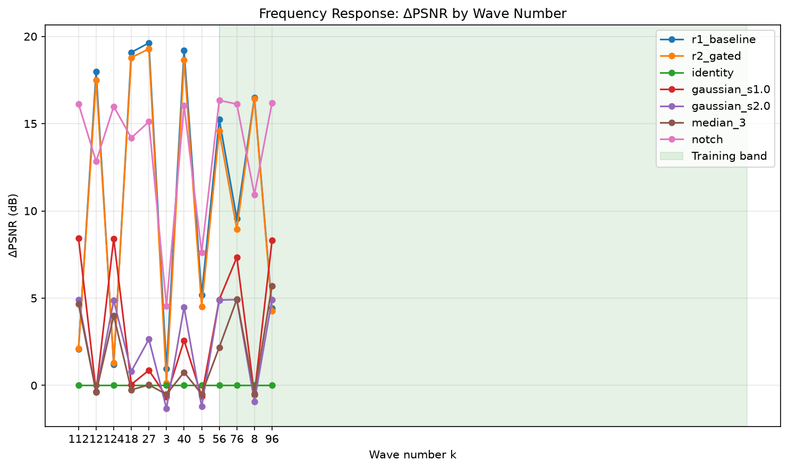

### r1_baseline — Frequency × Orientation
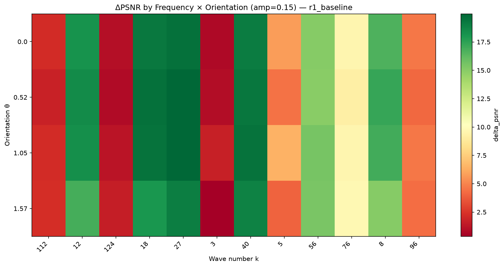

### r1_baseline — Frequency × Amplitude
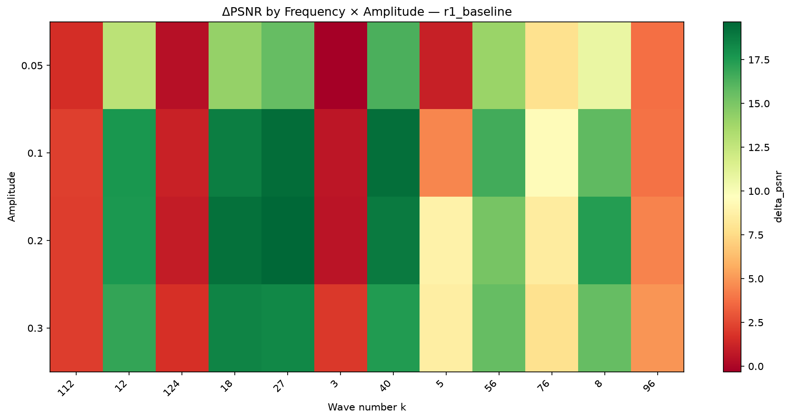

### r2_gated — Frequency × Orientation
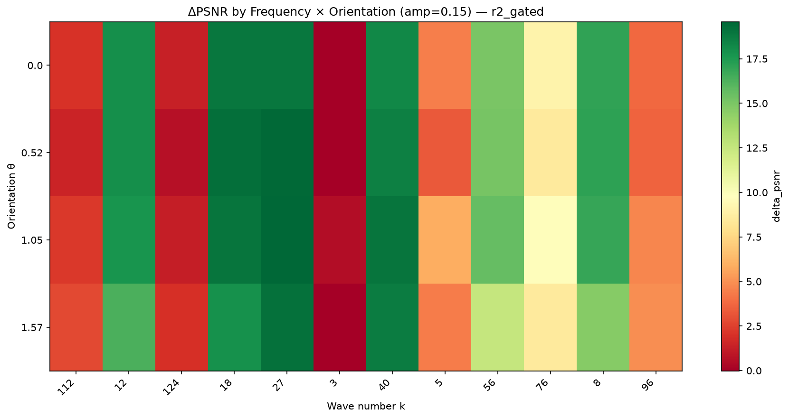

### r2_gated — Frequency × Amplitude
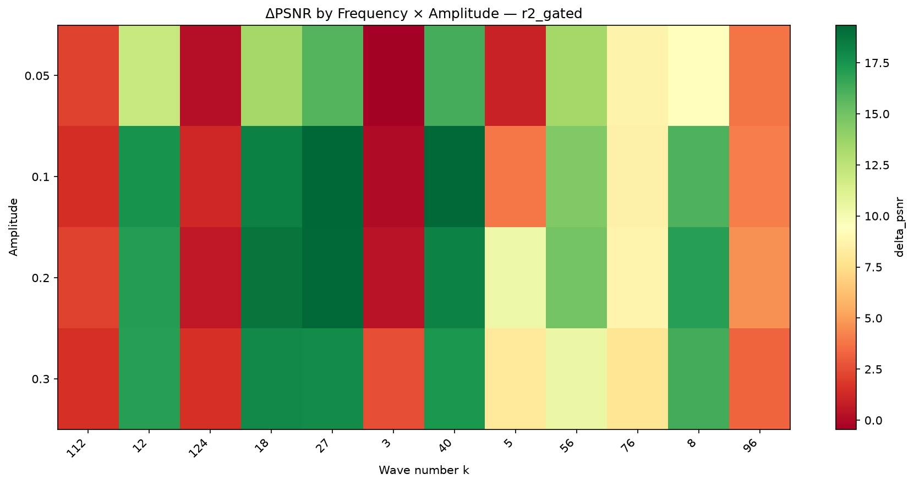

### identity — Frequency × Orientation
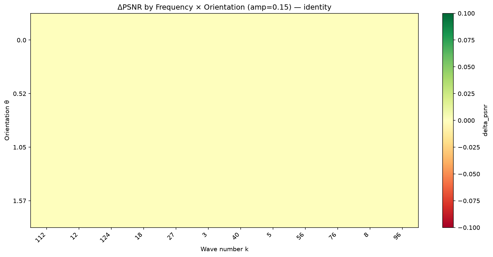

### identity — Frequency × Amplitude
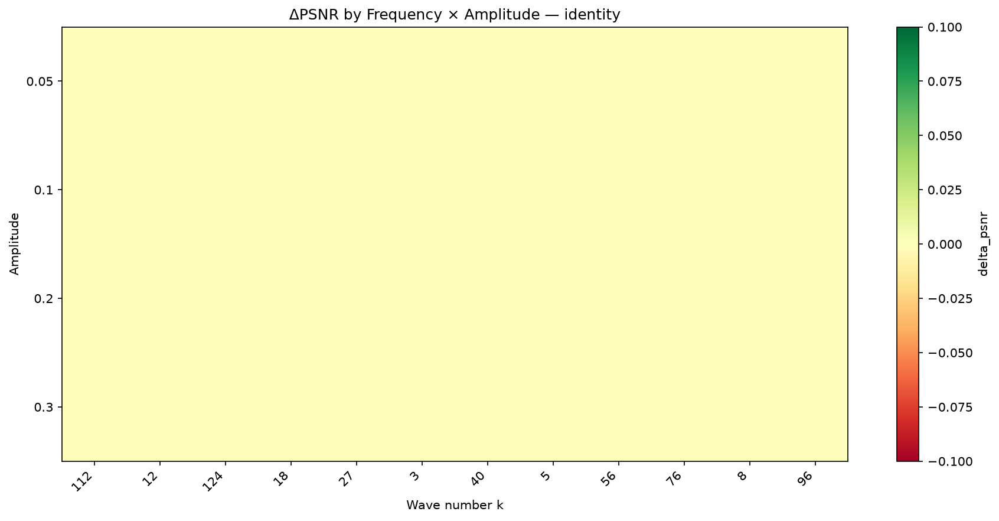

### gaussian_s1.0 — Frequency × Orientation
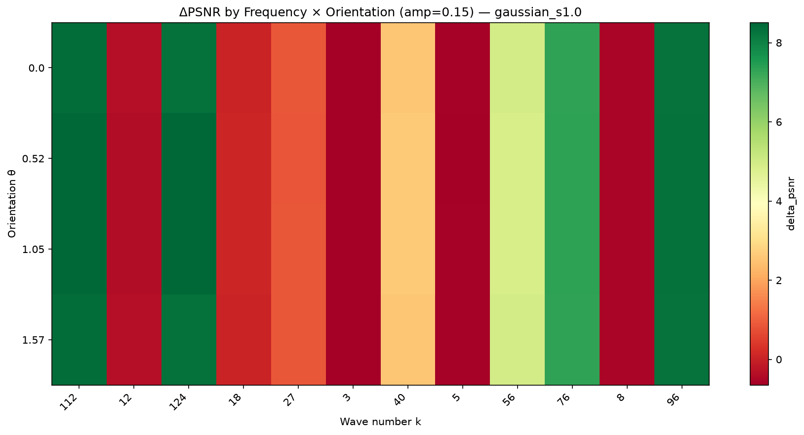

### gaussian_s1.0 — Frequency × Amplitude
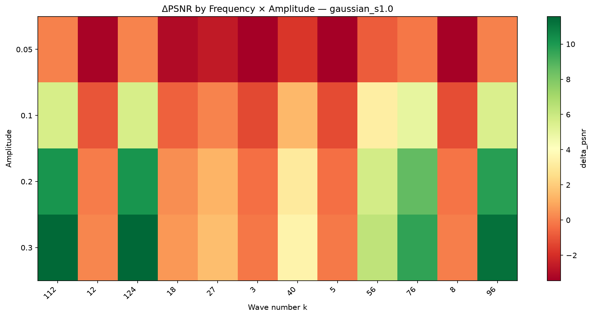

### gaussian_s2.0 — Frequency × Orientation
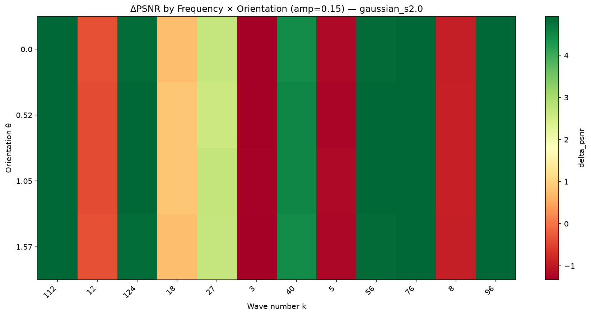

### gaussian_s2.0 — Frequency × Amplitude
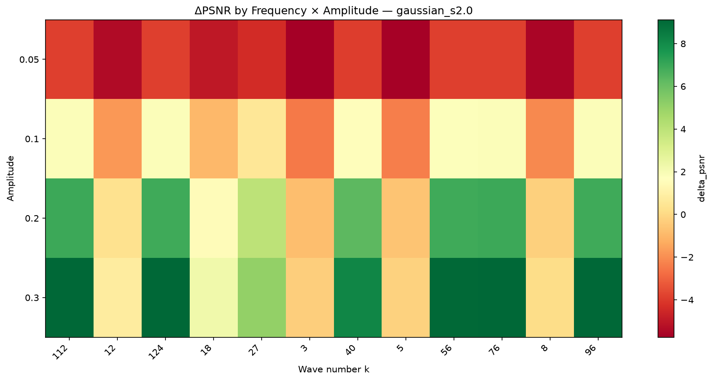

### median_3 — Frequency × Orientation
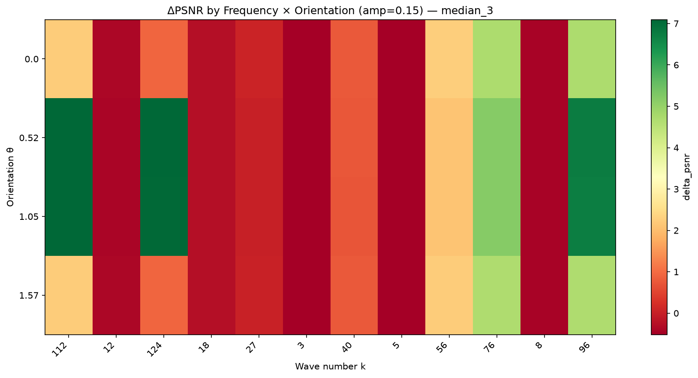

### median_3 — Frequency × Amplitude
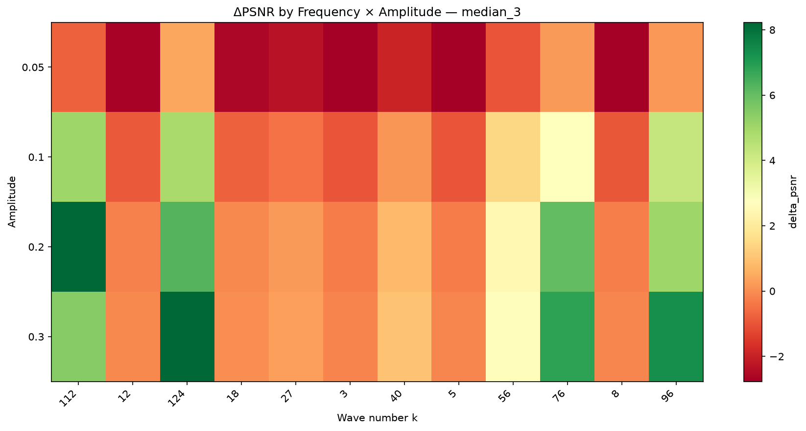

### notch — Frequency × Orientation
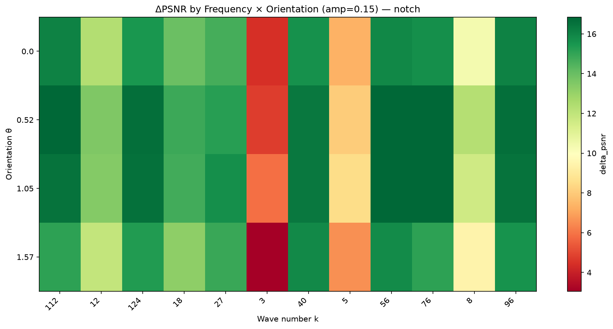

### notch — Frequency × Amplitude
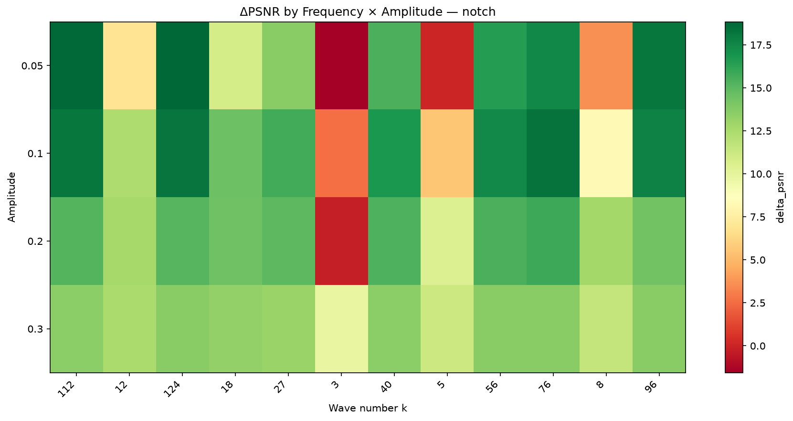

